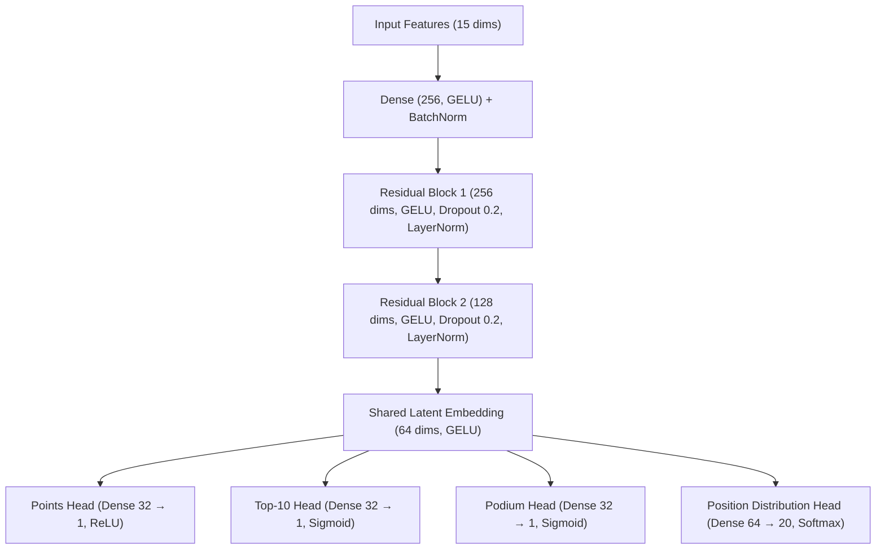

# 2026 Formula 1 Multi-Task ML Model & Prediction Agent

[](https://www.tensorflow.org/)
[](https://cloud.google.com/tpu)
[](https://www.python.org/)
[](https://colab.research.google.com/)

An end-to-end **Multi-Task Deep Neural Network** and autonomous **Prediction Agent** engineered for the **2026 FIA Formula One World Championship**. Built with TensorFlow's `TPUStrategy` for high-throughput training and inference on Google Cloud TPUs (with seamless GPU/CPU fallback), the system models the landmark 2026 technical regulations, simulates full championship seasons, and evaluates classification performance using **F1-Scores**.

---

## Table of Contents

- [Key Features](#-key-features)
- [Repository Structure](#-repository-structure)
- [2026 F1 Regulation & Domain Modeling](#-2026-f1-regulation--domain-modeling)
- [Multi-Task Neural Network Architecture](#-multi-task-neural-network-architecture)
- [Quick Start](#-quick-start)
  - [Option 1: Google Colab with Cloud TPU](#option-1-google-colab-with-cloud-tpu)
  - [Option 2: Local Python Environment](#option-2-local-python-environment)
- [Using the `F1PredictionAgent` API](#-using-the-f1predictionagent-api)
- [Evaluation Metrics](#-evaluation-metrics)

---

## Key Features

- **2026 Technical Regulation Physics Engine**: Synthetic telemetry and race simulator incorporating active aerodynamics (**Z-Mode** high downforce & **X-Mode** low drag), the 50/50 electric-combustion power split (350 kW MGU-K), 100% sustainable fuels, and updated 2026 driver/constructor pairings.
- **Distributed Cloud TPU Acceleration**: Native `tf.distribute.TPUStrategy` support for multi-core TPU pods (`v2`, `v3`, `v4`, `v5e`) with automatic fallback to local GPU or CPU strategies.
- **4-Head Multi-Task Learning**: Simultaneously predicts expected championship points, Top-10 points finish probability, Top-3 podium finish probability, and the full 20-position finishing distribution from a shared latent race embedding.
- **Rigorous F1-Score Evaluation**: Optimizes and reports Binary, Macro, and Weighted **F1-Scores**, Precision, Recall, and ROC-AUC to handle class imbalance across podium (15%) and points-paying (50%) finishes.
- **Autonomous Strategy & Prediction Agent**: High-level `F1PredictionAgent` interface for single Grand Prix forecasts, Monte Carlo World Championship simulations (WDC & WCC), and natural-language tactical queries.

---

## Repository Structure

```text
F1/
├── f1_2026_agent.py                   # Core Python module: dataset engine, multi-task DNN, and F1PredictionAgent
├── f1_2026_tpu_prediction_agent.ipynb # Self-contained 24-cell Jupyter Notebook optimized for Google Colab TPU
├── generate_colab_notebook.py         # Generator script that builds the Colab Jupyter Notebook programmatically
├── F1_2026_COLAB_TPU_GUIDE.md         # Quick-reference guide for configuring Google Colab TPU runtimes
└── README.md                          # Project documentation
```

---

## 2026 F1 Regulation & Domain Modeling

### 1. 2026 Constructor & Driver Grid
The simulation models 10 constructors and 20 drivers with specialized ratings (`base_skill`, `wet_skill`, `racecraft`) and chassis/power unit parameters (`engine_power`, `active_aero`, `mech_grip`, `pit_efficiency`):

| Constructor | Power Unit Supplier | 2026 Driver Line-Up |
| :--- | :--- | :--- |
| **Scuderia Ferrari** | Ferrari | Charles Leclerc (`LEC`), Lewis Hamilton (`HAM`) |
| **Red Bull Racing** | Red Bull Ford | Max Verstappen (`VER`), Liam Lawson (`LAW`) |
| **McLaren** | Mercedes | Lando Norris (`NOR`), Oscar Piastri (`PIA`) |
| **Mercedes-AMG** | Mercedes | George Russell (`RUS`), Kimi Antonelli (`ANT`) |
| **Aston Martin** | Honda | Fernando Alonso (`ALO`), Lance Stroll (`STR`) |
| **Williams** | Mercedes | Carlos Sainz (`SAI`), Alexander Albon (`ALB`) |
| **Audi F1 Team** | Audi | Nico Hülkenberg (`HUL`), Gabriel Bortoleto (`BOR`) |
| **Racing Bulls** | Red Bull Ford | Yuki Tsunoda (`TSU`), Isack Hadjar (`HAD`) |
| **Alpine** | Mercedes | Pierre Gasly (`GAS`), Jack Doohan (`DOO`) |
| **Haas F1 Team** | Ferrari | Esteban Ocon (`OCO`), Oliver Bearman (`BEA`) |

### 2. Input Feature Vector (15 Features)
Each driver-race sample is represented by 15 standardized features (`FEATURE_COLS`):

| Category | Features | Description |
| :--- | :--- | :--- |
| **Driver Attributes** | `driver_base_skill`, `driver_wet_skill`, `driver_racecraft` | Dry pace, wet-weather control, and wheel-to-wheel overtaking/defense |
| **Car & Team Specs** | `team_engine_power`, `team_active_aero`, `team_mech_grip`, `team_pit_efficiency` | 2026 PU output, X/Z-mode aero efficiency, mechanical grip, and pit stop execution |
| **Track & Qualifying** | `grid_position`, `circuit_power_bias`, `circuit_aero_bias`, `circuit_overtaking`, `circuit_is_street` | Starting grid slot and circuit-specific sensitivity across 23 calendar venues |
| **Race Conditions** | `track_temperature`, `is_wet`, `safety_car_deployed` | Ambient/track thermal state, precipitation flag, and Safety Car intervention |

---

## Multi-Task Neural Network Architecture

Built via `build_f1_multitask_model()`, the model uses residual dense blocks with **GELU** activations, **Batch/Layer Normalization**, and **Dropout** to learn a 64-dimensional `race_latent_embedding` before branching into four task-specific heads:



| Output Head | Layer Name | Task Type | Activation | Target / Output |
| :--- | :--- | :--- | :--- | :--- |
| **Points Scorer** | `points_out` | Regression | `ReLU` | Expected FIA points ($25, 18, 15, \dots, 0$) |
| **Top-10 Finisher** | `top10_out` | Binary Classification | `Sigmoid` | Probability of finishing in P1–P10 |
| **Podium Finisher** | `podium_out` | Binary Classification | `Sigmoid` | Probability of finishing in P1–P3 |
| **Full Grid Classifier** | `position_out` | 20-Class Classification | `Softmax` | Probability distribution across P1–P20 |

---

## Quick Start

### Option 1: Google Colab with Cloud TPU

1. Open [Google Colab](https://colab.research.google.com) and upload `f1_2026_tpu_prediction_agent.ipynb`.
2. Enable the Cloud TPU hardware accelerator:
   - Navigate to **Runtime** → **Change runtime type**.
   - Select **TPU** (e.g., TPU v2 / v3 / v4 / v5e) under **Hardware accelerator** and click **Save**.
3. Select **Runtime** → **Run all** to execute the complete 24-cell pipeline (TPU initialization, synthetic dataset generation, distributed multi-task training, F1-score diagnostics, and championship simulations).

> To regenerate `f1_2026_tpu_prediction_agent.ipynb` locally at any time, run:
> ```bash
> python generate_colab_notebook.py
> ```

### Option 2: Local Python Environment

1. **Install dependencies**:
   ```bash
   pip install numpy pandas scikit-learn matplotlib seaborn tensorflow
   ```

2. **Train and run the agent in Python**:
   ```python
   from sklearn.preprocessing import StandardScaler
   from f1_2026_agent import (
       initialize_tpu_strategy,
       generate_f1_dataset,
       build_f1_multitask_model,
       F1PredictionAgent,
       FEATURE_COLS
   )

   # 1. Initialize TPU (or fallback to CPU/GPU automatically)
   strategy = initialize_tpu_strategy()

   # 2. Generate synthetic 2026 season dataset (1,250 races = 25,000 driver entries)
   df = generate_f1_dataset(n_races=1250, random_seed=42)
   scaler = StandardScaler()
   X = scaler.fit_transform(df[FEATURE_COLS].values)

   # 3. Build & compile Multi-Task Model inside strategy scope
   with strategy.scope():
       model = build_f1_multitask_model(input_dim=len(FEATURE_COLS))
       model.compile(
           optimizer="adam",
           loss={
               "points_out": "huber",
               "top10_out": "binary_crossentropy",
               "podium_out": "binary_crossentropy",
               "position_out": "sparse_categorical_crossentropy",
           }
       )

   # 4. Fit model
   model.fit(
       X,
       {
           "points_out": df["points"].values,
           "top10_out": df["is_top10"].values,
           "podium_out": df["is_podium"].values,
           "position_out": df["position_class"].values,
       },
       epochs=20,
       batch_size=128,
       verbose=1
   )

   # 5. Initialize Autonomous Prediction Agent
   agent = F1PredictionAgent(model=model, scaler=scaler)
   ```

---

## Using the `F1PredictionAgent` API

### 1. Predict a Single Grand Prix
Forecasts the complete 20-driver finishing order, expected finishing position (`Exp_Pos`), predicted points, and probabilities for Podium, Win, and Top-10 finishes:

```python
race_df = agent.predict_grand_prix(
    circuit_name="Italy (Monza)",
    is_wet=0.0,
    track_temp=32.0
)
print(race_df.head(10))
```

### 2. Simulate the Full 2026 World Championship (Monte Carlo)
Runs $N$ full-season simulations across all 23 circuits with dynamic weather and temperature variations to project the **World Drivers' Championship (WDC)** and **World Constructors' Championship (WCC)** tables:

```python
wdc_standings, wcc_standings = agent.simulate_2026_season(n_simulations=50)
print(wdc_standings.head(10))
print(wcc_standings)
```

### 3. Natural Language Tactical Queries
Ask scenario-specific questions regarding wet weather, power-sensitive tracks, or constructor performance:

```python
# Wet race analysis at Spa-Francorchamps
summary, df_top = agent.query("Who wins if it rains at Spa?")
print(summary)

# Audi factory entry evaluation
summary, df_audi = agent.query("How will Audi perform in 2026?")
print(summary)

# High-speed power circuit projection
summary, df_monza = agent.query("Predictions for Monza power circuit?")
print(summary)
```

---

## Evaluation Metrics

The pipeline evaluates each task head with specialized metrics:

- **Classification Heads (`top10_out` & `podium_out`)**:
  - **Binary, Macro, and Weighted F1-Scores**: Balances Precision and Recall across both balanced (Top-10) and imbalanced (Top-3 Podium) targets.
  - **ROC-AUC & Confusion Matrices**: Evaluates probability calibration and decision threshold sensitivity.
- **Regression Head (`points_out`)**:
  - **Mean Absolute Error (MAE)** & **Root Mean Squared Error (RMSE)** on championship points scored.
- **Multi-Class Grid Head (`position_out`)**:
  - Expected finishing position calculation via probability-weighted rank summation:
    $$\mathbb{E}[\text{Pos}] = \sum_{k=1}^{20} k \cdot P(\text{Position} = k)$$
